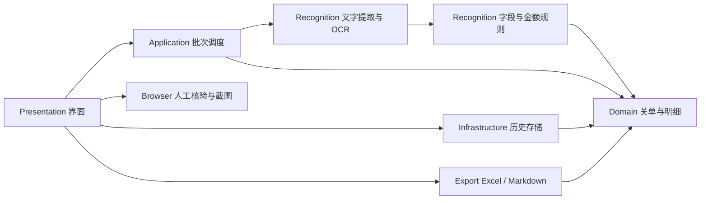

# 架构设计

更新：2026-10-10，v0.1.0 整体代码审核后。

## 处理流程

## 源码目录与职责

以下目录均位于 `src/CustomsClearanceConsole`，保留同一程序集与命名空间，避免为当前桌面工具增加无必要的项目依赖。

| 目录 | 职责与主要入口 |
| --- | --- |
| Domain | 关单、商品明细、文字坐标和历史状态；格式及币种名称。旧复核属性集中在 `DeclarationLineTotal.Legacy.cs`。 |
| Application | `ScanPlan` 预检和不可变文件清单；`BatchScanner` 调度、取消、重复分组与合计。 |
| Recognition | `DocumentExtractor` 选择 PDF 文字层或 OCR；`DeclarationParser` 按表头、商品行、几何定位和规则拆分；`RapidOcrEngine` 管理模型；`PdfiumNative` 管理原生 PDF。 |
| Infrastructure | 路径、日志、历史迁移、原子保存和文件清理。`StateMigration` 专管历史兼容，`AtomicFile` 统一完整文件发布。 |
| Browser | 会话生命周期、页面/框架、截图、卡片和测试支持按文件拆分；`CdpClient` 独立负责通信；URL 与回填策略单独维护。 |
| Export | Excel、Markdown 导出及导出数据校验。 |
| Presentation | 主窗体按布局、绘制、记录、批次、核验、文件操作与窗口生命周期拆分；包含控件和弹窗。 |
| Diagnostics | 命令行注册与参数校验、OCR/资源/浏览器自检及导出样本。 |
| BrowserScripts | 实际浏览器页面脚本，嵌入资源名称保持兼容；回归复用相同脚本。 |
| RapidOcrSource | 保留第三方 OCR 实现及许可证；本次仅调整资源管理、异常传播及调试输出。 |

`Program.cs` 只负责启动环境、界面入口和命令行分流。大型类采用按职责拆分的 partial 文件，拆分不改变序列化字段、公开功能或识别规则。

## 生命周期与失败处理

- 窗口拥有浏览器会话、菜单、定时器和绘制图片，统一释放；关闭或批次切换后，失效会话不再回填结果。
- 批次创建并释放提取器，提取器拥有 OCR 引擎；OCR 门闩协调执行与释放。提取返回后再次检查取消，迟到结果不进入当前批次。
- 模型、推理会话、图像矩阵、裁剪及临时图像显式释放；初始化中途失败同样清理已取得的资源。PDF 读取失败不能留下原生库引用或固定内存。
- CDP 命令按 ID 关联响应；关闭与注册共用状态锁，关闭时终止在途命令。统一截止时间覆盖发送排队、写入和响应等待。
- 状态与两类导出共用 `AtomicFile`：同路径写入串行化，唯一同目录临时文件写完并刷盘后整体替换。写入失败保留原文件；多个实例的历史不会自动合并。
- 历史迁移修复空值；币种规范化后冲突金额标记需关注并排除。旧版复核字段仍可读写、显示和导出，但已删除不再运行的双引擎合并流程。
- 保存失败在界面明确提示，退出时允许取消关闭，避免把保存失败当作成功。

## 数据边界与运行

每批最多 200 个当前层文件。原关单只读；历史通常保存在 `%LocalAppData%\关单核验台`，测试可用 `CUSTOMS_CONSOLE_DATA` 隔离。截图保存在用户设置的目录，OCR 临时目录统一清理。在线核验由用户主动触发，验证码在浏览器中人工完成。

根目录启动器调用包内 `runtime/dotnet.exe app/关单核验台.dll`。运行时、模型、PDFium 和字体随完整便携包提供。

## 验证入口

核心规则、迁移与保存：`tests/CoreRegression`；CDP 真实 WebSocket 连接：`tests/TransportRegression`；实际 OCR 与原生资源：`--ocr-self-test`、`--resource-self-test`；完整浏览器路径：`--browser-e2e`；界面：`--ui-contract-self-test` 与 `--ui-state-snapshot`。全部命令与参数以 `--help` 为准。

本次验证证据和剩余限制见[整体代码审核报告](code-review-v0.1.0.md)。
