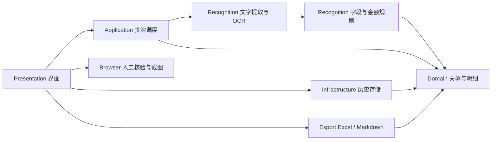

# 架构设计

更新：2026-10-10，v0.2.0。

## 处理流程

## 源码目录与职责

以下目录均位于 `src/CustomsClearanceConsole`，保留同一程序集与命名空间，避免为当前桌面工具增加无必要的项目依赖。

| 目录 | 职责与主要入口 |
| --- | --- |
| Domain | 关单、商品明细、文字坐标和历史状态；数字格式及币种名称。旧复核属性集中在 `DeclarationLineTotal.Legacy.cs`。 |
| Application | `ScanPlan` 预检和不可变文件清单；`BatchScanner` 调度、取消、重复分组与合计。 |
| Recognition | `DocumentExtractor` 选择 PDF 文字层或 OCR；`DeclarationParser` 按表头、商品行、几何定位和规则拆分；`RapidOcrEngine` 管理模型；`PdfiumNative` 管理原生 PDF。 |
| Infrastructure | 路径、日志、历史迁移、原子保存和文件清理。`StateMigration` 专管历史兼容，`AtomicFile` 统一完整文件发布。 |
| Browser | 会话生命周期、页面/框架、截图、卡片和测试支持按文件拆分；`CdpClient` 独立负责通信；`BrowserProfileStore` 管理核验窗口的专用浏览器配置；URL 与回填策略单独维护。 |
| Export | Excel、Markdown 导出及导出数据校验。 |
| Presentation | 主窗体按布局、绘制、记录、批次、核验、文件操作与窗口生命周期拆分；包含控件和弹窗。`PaintCache` 提供共享绘制资源和批量重绘。 |
| Diagnostics | 命令行注册与参数校验、OCR/资源/浏览器自检及导出样本。 |
| BrowserScripts | 实际浏览器页面脚本，嵌入资源名称保持兼容；回归复用相同脚本。 |
| RapidOcrSource | 保留第三方 OCR 实现及许可证；本次仅调整资源管理、异常传播及调试输出。 |

`Program.cs` 只负责启动环境、界面入口和命令行分流。大型类采用按职责拆分的 partial 文件，拆分不改变序列化字段、公开功能或识别规则。

## 生命周期与失败处理

- 窗口拥有浏览器会话、菜单、定时器和绘制图片，统一释放；关闭或批次切换后，失效会话不再回填结果。
- 批次创建并释放提取器，提取器拥有 OCR 引擎；OCR 门闩协调执行与释放。提取返回后再次检查取消，迟到结果不进入当前批次。
- 模型、推理会话、图像矩阵、裁剪及临时图像显式释放；初始化中途失败同样清理已取得的资源。PDF 读取失败不能留下原生库引用或固定内存。
- CDP 命令按 ID 关联响应；关闭与注册共用状态锁，关闭时终止在途命令。统一截止时间覆盖发送排队、写入和响应等待。
- 状态与两类导出共用 `AtomicFile`：同路径写入串行化，唯一同目录临时文件写完并刷盘后整体替换。写入失败保留原文件；多个实例的历史不会自动合并。
- 历史迁移修复空值；币种规范化后冲突金额标记需关注并排除。旧版复核字段仍可读写、显示和导出，但已删除不再运行的双引擎合并流程。
- 保存失败在界面明确提示，退出时允许取消关闭，避免把保存失败当作成功。

## 数据边界与运行

每批最多 200 个当前层文件。原关单只读；历史通常保存在 `%LocalAppData%\关单核验台`，测试可用 `CUSTOMS_CONSOLE_DATA` 隔离。截图保存在用户设置的目录，OCR 临时目录统一清理。在线核验由用户主动触发，验证码在浏览器中人工完成。

根目录启动器调用包内 `runtime/dotnet.exe app/关单核验台.dll`。运行时、模型、PDFium 和字体随完整便携包提供。

## 界面刷新与绘制

- 记录表原地更新行（数量变化时只增删末尾行），不再整表清空重建；分页、筛选和搜索变化时回到首行，识别过程中保持当前滚动位置。
- 刷新统计、表格和筛选时用 `Redraw.Suspend`（WM_SETREDRAW）暂停整个工作区的绘制，全部数据就绪后统一重绘一次；统计、金额、筛选、标题和状态面板只在内容变化时重绘。
- 按钮图标只在状态或 DPI 变化时替换；窗口尺寸未变时跳过响应式布局；拖动窗口边缘时整窗合成绘制。
- 单元格与面板绘制使用 `PaintCache` 缓存的字体、画笔、画刷和图标，不在每次重绘时创建 GDI 对象。表格每格重置 SmoothingMode / PixelOffsetMode，避免圆角绘制状态产生灰色接缝。

## 核验浏览器

核验窗口启动系统默认（或已安装）的 Edge / Chrome，经本机调试端口自动填号和截图。Chromium 136 起禁止在日常个人配置上开启调试端口，因此核验窗口使用专用配置：交互会话复用 `数据目录\BrowserProfile\<浏览器>[-n]` 中的固定配置（保留缩放、站点权限和 Cookie），并发窗口按槽位分配，均被占用时与自动化测试一样使用 `BrowserProfiles` 下的一次性配置（12 小时后清理）。调试端口只监听 127.0.0.1，不开放 `--remote-allow-origins`。关闭会话时先请求浏览器正常退出，超时才结束进程。

## 维护要点

- DPI 按 96 DPI 逻辑尺寸搭建，交给 `DpiLayout` / `DpiDialog` 缩放；不要在构造期间重复缩放。
- 弹窗边框统一用 `PopupFrame`，外框保留 1px 内边距，停靠的子区域不会遮住边框。
- CDP 的 URL 片段来自 urlFragment，页内路由切换需要监听 navigatedWithinDocument。官网查询框架异步加载，卡片只安装在顶层。
- 浏览器截图含 60 秒整体上限、卡片看门狗和逐步日志。受控仿真测试不能替代真实单一窗口网站验收。
- 历史记录需要重新识别才能应用新规则；旧双引擎复核字段只保留读写兼容。

## 验证入口

核心规则、迁移与保存：`tests/CoreRegression`；CDP 真实 WebSocket 连接：`tests/TransportRegression`；实际 OCR 与原生资源：`--ocr-self-test`、`--resource-self-test`；完整浏览器路径：`--browser-e2e`；界面：`--ui-contract-self-test` 与 `--ui-state-snapshot`。全部命令与参数以 `--help` 为准。Windows CI（`.github/workflows/windows-ui-v2.yml`）在每次推送和合并请求时执行全部门禁。
