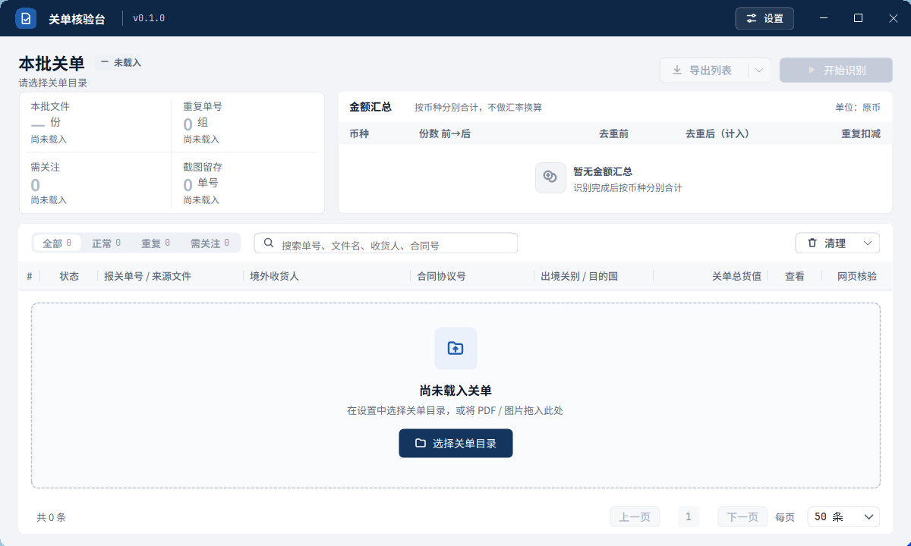

# v0.1.0 界面与使用说明

本页按 v0.1.0 的实际桌面界面及操作实现校对。旧版设计稿仅作历史参考；当前截图与入口以本页和程序为准。

## 主界面

- 最低 1200×720。标题栏显示“关单核验台”、版本号及右上方“设置”；工作区显示“本批关单”、目录或未载入提示，以及“导出列表”“开始识别”。
- 左侧统计面板包含本批文件、重复单号、需关注和截图留存四项；右侧“金额汇总”包含币种、份数前→后、去重前、去重后（计入）和重复扣减。
- 海军蓝、灰白底色，统一线性图标。金额使用等宽字体右对齐；18 位单号下方显示来源文件。
- 全部、正常、重复、需关注四种筛选显示数量；重复与需关注可重叠。搜索匹配单号、文件名、收货人和合同号。
- 汇总始终覆盖本批全部记录，分别列出去重前/后金额；各币种独立显示，超长金额或较多币种可滚动查看。
- 六个业务字段完整保留；列宽可调整，空间不足时横向滚动。长文本保留完整单元格提示。
- 保留多单元格选择、Ctrl+C、右键复制、分页和双击打开源文件。
- 每条记录通过“明细”打开只读商品项，通过“校验”打开网页；截图保存后显示“已留存”。记录区底部可切换页码及每页 50 / 100 / 200 条。

## 操作顺序

1. 在标题栏“设置”中选择关单目录及截图目录并保存，也可拖入 PDF / 图片载入新批次。
2. 点击“开始识别”；需要停止时点击“取消识别”。
3. 使用筛选、搜索和“明细”检查结果，通过“导出列表”选择 Excel 或 Markdown。Excel 含关单列表、关单明细和币种汇总三张工作表，两种格式均导出本批全部记录。
4. 需要网页核验时点击记录的“校验”，人工输入验证码并查询，再点击网页卡片“长截图”。

## 批次生命周期

先生成不可变文件清单，检查有效目录、支持格式、去重后的数量 1—200，再替换当前批次。预检失败保留旧批次。

识别时显示当前文件与进度，主按钮切换为取消；清理、导出、目录修改、新批次和网页核验被锁定。PDF/OCR 工作在后台执行。取消保留已完成结果；已经开始的 ONNX 推理需等待当前调用返回，返回后再次检查取消，迟到结果不进入当前批次。

## 独立状态

识别状态与提示、重复标记与提示、截图路径分别保存。截图仅显示“已留存”，不能覆盖需关注/识别失败。旧版丢失原状态的重复记录迁移为需关注，建议重新识别。删除源文件关联记录后重新选择去重代表记录。

## 清理

清理入口集中在记录区菜单。列表清理一次确认，只清除记录。源文件或截图清理两次确认；完整目录、数量与范围在确认框中显示，可滚动和复制路径。仅处理当前目录允许类型，拒绝磁盘根目录，移入 Windows 回收站。部分失败保留并报告。

## 网页核验

三步：点击“校验”打开并填号 → 用户输入验证码并查询 → 用户点击网页卡片“长截图”。需要安装 Edge 或 Chrome；优先使用受支持的系统默认浏览器，否则回退到已安装的 Edge / Chrome。查询完成后不会自动截图。保存前检查查询单号与结果身份，未查询、身份不明或单号不一致时拒绝保存。保存成功后回填“已留存”，再次截图追加时间戳。

长截图逐块解码并立即绘制，保持图像输入流有效；超过 6000 万像素的页面提示改用浏览器分段保存。截图留存不代表海关审核或识别通过。
